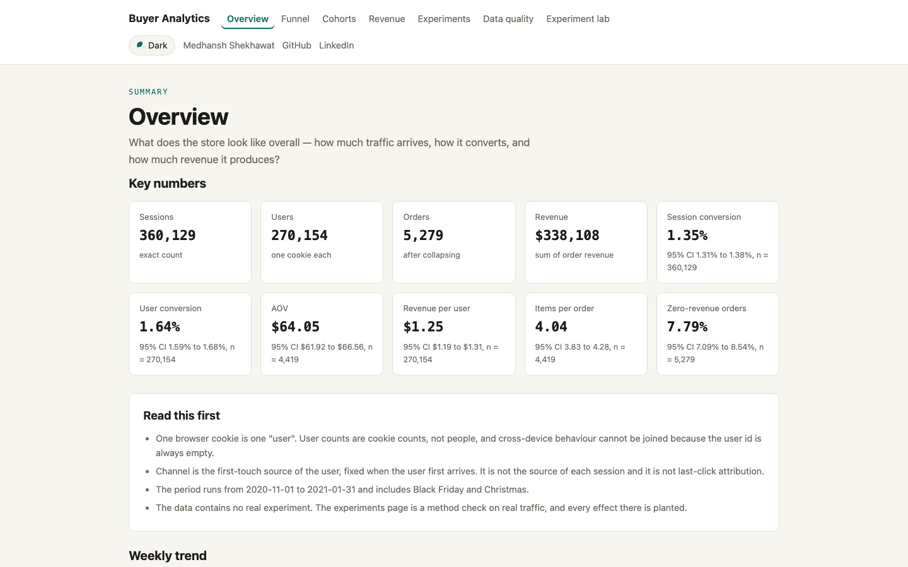
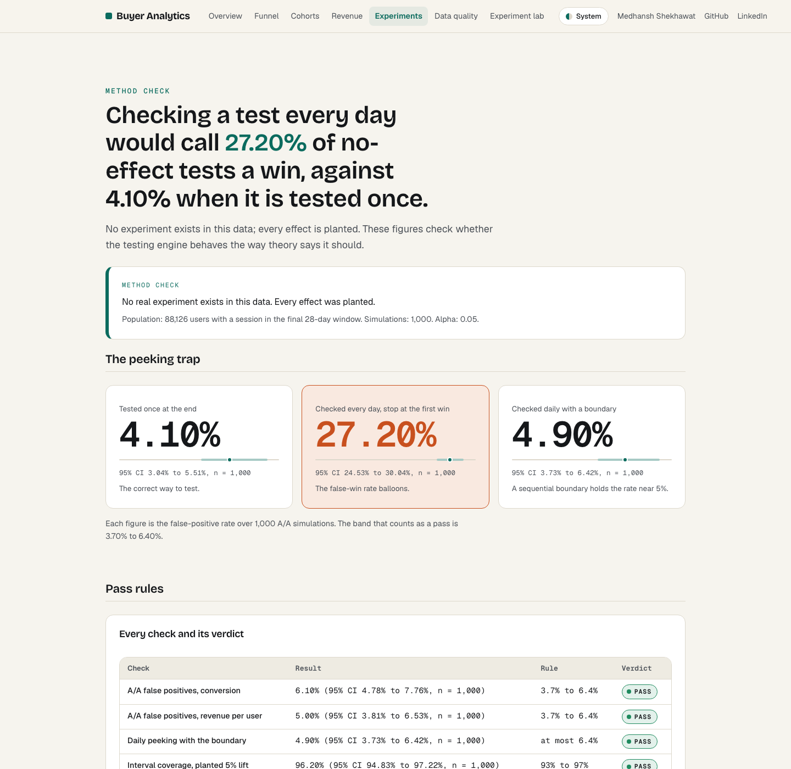

# Buyer Analytics

SQL-first product analytics and A/B-test method checks on the public GA4 export of the Google
Merchandise Store: 4.3 million events, 270,154 users, 1 November 2020 to 31 January 2021.

**Headline:** after the holidays revenue fell by $109,031 between two 28-day periods. Sessions
fell 12%, but orders per session fell from 1.94% to 1.02%: conversion explains 58% of the drop
(log change −0.640, 95% interval −0.718 to −0.559). Most of the apparent fall in order value
is a tracking fault: 24.2% of January orders record zero revenue, against 3.4% before.

**Live site:** https://buyer-analytics.vercel.app

Findings with intervals: [`docs/FINDINGS.md`](docs/FINDINGS.md). One-page recommendation:
[`docs/MEMO.md`](docs/MEMO.md).



## What is here

| Layer | Where | What |
|---|---|---|
| Plan | `ANALYSIS_PLAN.md` | Definitions and pass rules, committed before any result |
| Extract | `extract/pull_ga4.py` | One pull from BigQuery to daily Parquet, with a manifest |
| Models | `dbt/` | dbt on DuckDB: staging, intermediate, nine marts, 63 tests |
| Metrics | `dbt/models/semantic/` | MetricFlow semantic model: each metric defined once |
| Statistics | `analysis/` | Intervals, revenue decomposition, experiment engine |
| Results | `artefacts/*.json` | Every published number, with interval and n |
| Site | `site/` | Static pages reading the artefacts, plus a client-side experiment lab |

## The SQL

```
raw events (Parquet, one file per day)
  └─ stg_events                 one row per event, parameters unnested and typed
       ├─ int_user_first_touch  first-touch source and channel group per user
       ├─ int_orders            purchase events collapsed into orders
       └─ int_sessions          one row per session with funnel flags
            ├─ fct_sessions     ├─ fct_orders          ├─ fct_funnel_daily
            ├─ fct_cohort_retention                    ├─ fct_user_outcomes
            ├─ dim_users        ├─ dim_channel         ├─ dim_date
            └─ metrics_daily
```

Column-level contracts for every mart are in `CONTRACTS.md` and enforced by
`tests/contracts.py`. Business rules live in the models, not in Python. Two that matter:

- **Orders:** the export repeats purchase events. Events are collapsed per user and
  transaction id, or per session when the id is missing. 5,692 events become 5,279 orders.
- **Funnel:** a session reaches a step only if it reached the one before. The open counts are
  published beside it, because 41% of purchasing sessions skip a step.

Metrics in the semantic layer: `sessions`, `orders`, `revenue`, `new_users`,
`session_conversion`, `aov`, `items_per_order`, `zero_revenue_order_share`. A test queries
them through MetricFlow and compares the result with `metrics_daily`.

## How it was checked

- **Reconciliation** ([`docs/RECONCILIATION.md`](docs/RECONCILIATION.md)): events, users,
  sessions and purchase events match the raw files exactly, on all 92 days. The order and
  revenue gaps from collapsing are reported, not forced to match.
- **dbt:** 77 of 77 models and tests pass on the full data. CI runs the build on a committed
  3-day sample of real rows.
- **Experiment method**, against rules fixed in the plan:

| Check | Result | Rule | |
|---|---|---|---|
| A/A false positives, conversion | 6.1% | 3.7% to 6.4% | PASS |
| A/A false positives, revenue per user | 5.0% | 3.7% to 6.4% | PASS |
| Interval coverage, planted 5% / 10% / 20% lifts | 96.2% / 95.4% / 96.0% | 93% to 97% | PASS |
| Daily peeking with a sequential boundary | 4.9% | at most 6.4% | PASS |

Daily peeking without a correction gave 27.2% false wins. CUPED removed 1.1% of the variance,
because 4% of users have any history.

**The data contains no real experiment. Every effect was planted on random splits of real
users.** The limits of these checks are listed in the findings.



## What this does not establish

- Nothing causal: no experiment was run, and the period comparison is seasonal.
- Users are browser cookies. Cross-device journeys cannot be joined.
- Channel is the user's first touch, with 18.5% of users redacted by Google. It is not
  session source and not attribution.
- One retailer, three months, Black Friday and Christmas included.

## Run it

```bash
python -m venv .venv && source .venv/bin/activate
pip install -r requirements.txt

python extract/pull_ga4.py --project <your-gcp-project>   # free BigQuery sandbox is enough
(cd dbt && dbt build --profiles-dir .)
python scripts/reconcile.py
python -m analysis.metrics
python -m analysis.decompose
python -m analysis.experiments --outcomes marts_out/fct_user_outcomes.parquet \
    --out artefacts/experiments.json
python scripts/build_site.py
python -m http.server --directory site      # open http://localhost:8000

pytest                                       # add -m "not fulldata" without the data pull
```

The raw data is not committed. `data/raw/MANIFEST.json` records rows per day, and a test
checks the files against it.

## Author

Medhansh Shekhawat · [GitHub](https://github.com/Ghostboy789) ·
[LinkedIn](https://www.linkedin.com/in/medhansh-shekhawat)
